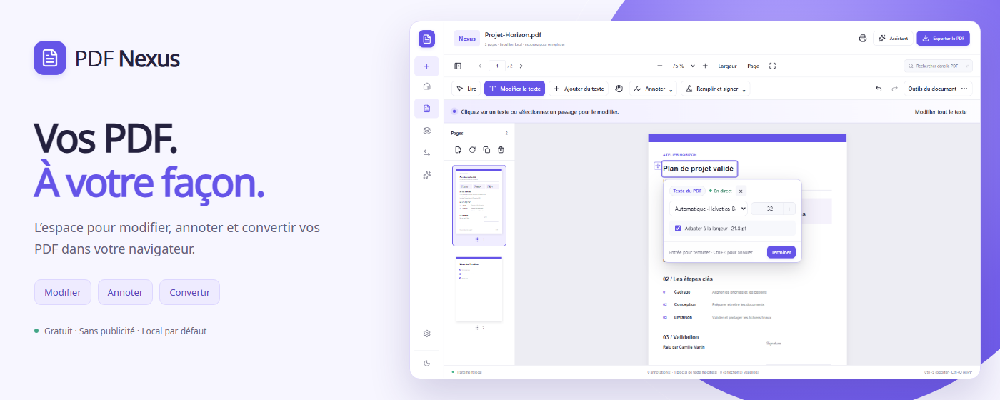
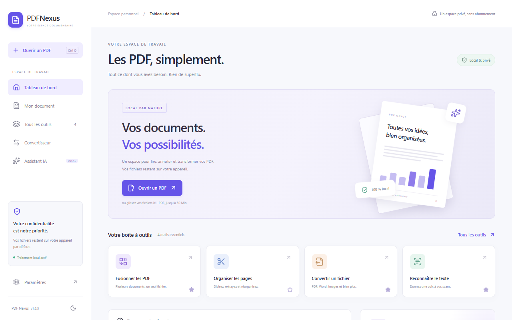
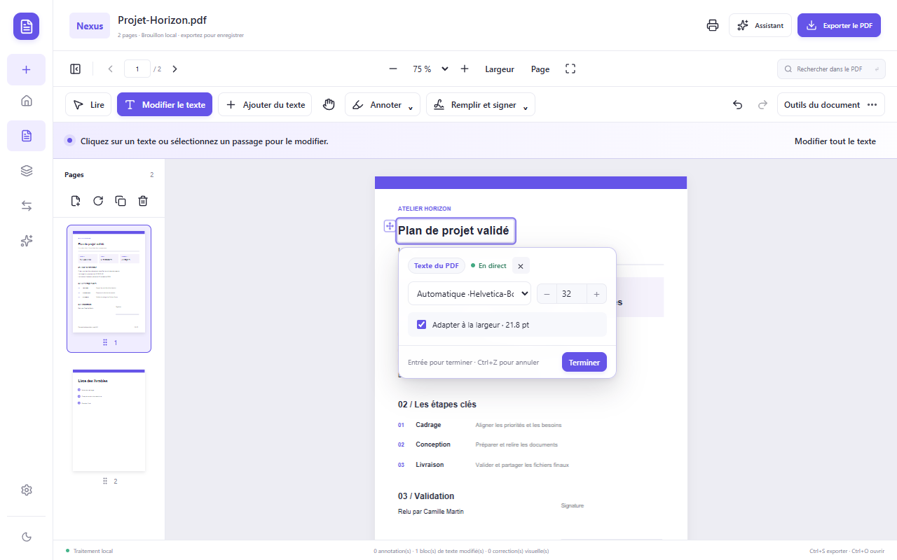
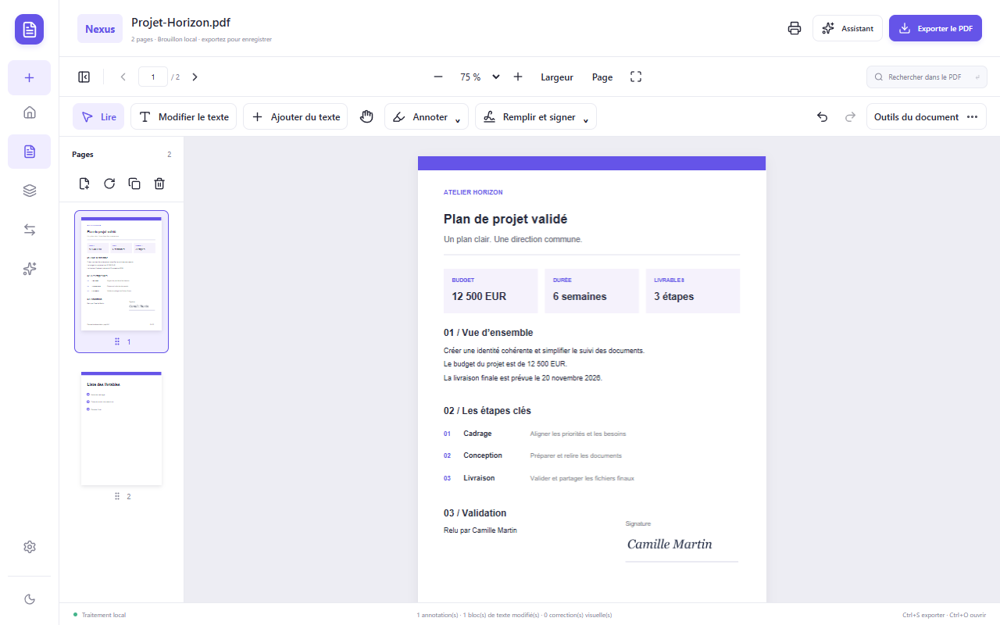
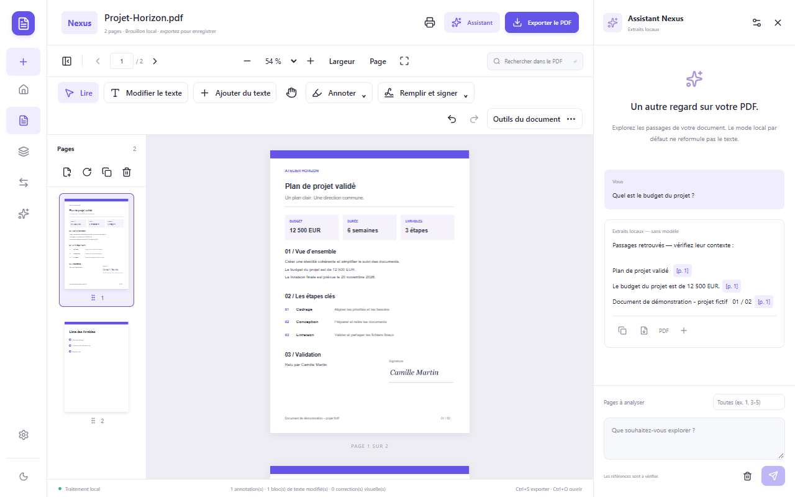
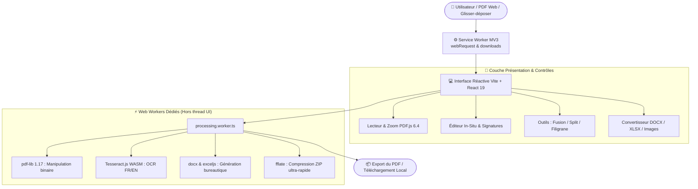

<div align="center">


# PDF Nexus

**L'atelier PDF tout-en-un, ultra-rapide et 100% privé pour votre navigateur.**  
_Éditez, organisez, convertissez, signez et analysez vos PDF directement dans Google Chrome & Microsoft Edge — sans aucun serveur externe._

[](docs/CHANGELOG.md)
[](public/manifest.json)
[](docs/PRIVACY.md)
[](LICENSE)
[](#-auteur--crédits)

---

### 🚀 [Installer sur le Chrome Web Store](https://chromewebstore.google.com/detail/dkpcbfafcmhacekpknhklbdkioaoamde)

[Fonctionnalités](#-fonctionnalités-phares) • [Galerie & Captures](#-galerie-de-linterface) • [Installation](#-installation--démarrage-rapide) • [Architecture](#-architecture-technique) • [Confidentialité](#-confidentialité--zéro-télémétrie) • [Auteur](#-auteur--crédits) • [Changelog](docs/CHANGELOG.md) • [English Guide](docs/USER-GUIDE.en.md)

---

<br />



</div>

<br />

> [!IMPORTANT]
> **Pourquoi confier vos documents confidentiels à des convertisseurs en ligne ?**  
> Contrairement aux services cloud tiers (iLovePDF, Smallpdf, etc.), **PDF Nexus traite vos documents sur votre machine par défaut**. Seul un mode IA distant configuré et confirmé explicitement envoie des extraits au fournisseur choisi. Vos documents restent strictement les vôtres.

<br />

## Correctif local 1.7.1 — lisibilité du code distribué

Le module de compatibilité `Object.create` de PDF.js est remplacé par l’implémentation native de Chrome et Edge ; ses anciens replis ActiveX, iframe et écriture de scripts sont retirés. ExcelJS utilise son bundle officiel sans polyfills. Les bundles Nexus et le Worker PDF sont livrés sans minification. Le build contrôle les scripts puis le ZIP final contre les régressions de code distant et les routines signalées. Voir [les instructions de nouvelle soumission](docs/STORE-RESUBMISSION-1.7.1.fr.md).

## Mise à jour locale 1.7.0

Brouillons récupérables, formulaires interactifs, panneau des objets ajoutés, export au choix avec aperçu, recherche par occurrence et remplacement global prévisualisé. Les textes ajoutés ont des polices réglables, plusieurs lignes, des poignées et des guides d’alignement. Voir [la réalisation des cinq priorités](docs/IMPLEMENTATION-ROADMAP.md) et [les résultats de validation](docs/VALIDATION.md).

## ✨ En un coup d'œil

| 🎯 Fonctionnalité             | 🛠️ Ce que fait PDF Nexus                                                                                            | 🔒 Confidentialité     |
| :---------------------------- | :------------------------------------------------------------------------------------------------------------------ | :--------------------- |
| **Lecteur & Annotation**      | Moteur PDF.js 6.4 accéléré, zoom fluide, surlignage, formes, notes, tampons, liens                                  | 100% Hors-ligne        |
| **Modification In-Situ**      | Modifiez directement le texte d'un PDF existant avec conservation des polices et correction visuelle intelligente   | Traitement local       |
| **Remplir & Signer**          | Signatures visuelles, cases imprimées ou de formulaire, réédition des ajouts après export et réouverture dans Nexus | Local                  |
| **Gestion des Pages**         | Réorganisation drag & drop, fusion, rotation 90°, suppression, duplication, division de documents                   | Local (pdf-lib)        |
| **Conversions Multi-formats** | Convertissez vers Word (DOCX), Excel (XLSX), images (PNG/JPG), TXT, ou regroupez en ZIP                             | Web Workers dédiés     |
| **OCR Embarqué**              | Moteur Tesseract.js (Français & Anglais) pour numériser des scans et générer des PDF recherchables                  | Modèle WASM local      |
| **Assistant IA Documentaire** | Extraits et recherche sémantique sans modèle, support natif de la Prompt API Chrome ou BYOK (OpenAI/Ollama)         | Choix de l'utilisateur |

<br />

---

## 🌟 Fonctionnalités Phares

### 📝 1. Édition de Texte Réelle & Précise

- **Modification directe sur la page** : Cliquez sur un bloc de texte exploitable d’un PDF natif pour le corriger ou le remplacer instantanément.
- **Préservation typographique** : Conservation automatique de la police d'origine, de la graisse, de la couleur et des coordonnées matricielles. Repli automatique vers Noto Sans pour les caractères rares.
- **Masquage de correction visuelle** : Pour les documents scannés ou les polices vectorisées complexes, un masque de correction contextuel s'applique sans déformer le document.

### ✍️ 2. Remplir & Signer vos Formulaires

- **Signature personnalisée** : Dessinez à la souris/stylet ou générez votre signature typographique directement sur votre appareil.
- **Détection des cases imprimées** : Détecte les carrés de formulaires papier scannés pour vous permettre de les cocher d'un simple clic.
- **Vrais champs** : Texte, plusieurs lignes, cases, radios et listes ; navigation par Tab.
- **Export au choix** : Conservez les champs interactifs dans une copie Nexus ou figez les ajouts et champs dans une copie de partage, après aperçu.

### 🗂️ 3. Espace d'Organisation & Fusion Multi-fichiers

- **Miniatures interactives** : Glissez-déposez les pages pour les réorganiser à volonté (raccourcis clavier `Alt + Flèches`).
- **Gestion complète** : Rotation (90°, 180°, 270°), suppression, duplication, pagination automatique et filigrane personnalisable (texte, opacité, angle, répétition).
- **Découpage & Extraction** : Extrayez une plage précise (`ex: 1, 3-5, 8`) ou scindez un PDF volumineux en plusieurs fichiers indépendants.

### 🔄 4. Convertisseur Universel Hors-Ligne

- **PDF vers Word (.docx)** : Extraction textuelle structurée et mise en page compatible Microsoft Word & LibreOffice.
- **PDF vers Tableaux Excel (.xlsx)** : Reconnaissance des grilles régulières et export structuré en feuilles de calcul.
- **Images & Compression** : Export de pages en PNG ou JPEG haute résolution, compression visuelle paramétrable, et packaging de lots en archive `.zip` ultra-rapide.

### 🔍 5. OCR Local Embarqué (Reconnaissance Optique de Caractères)

- Moteur **Tesseract.js** intégré avec dictionnaires français et anglais embarqués.
- Transformez vos scans et photos de documents en **PDF recherchables** grâce à l'injection d'une couche de texte invisible positionnée avec exactitude sous chaque mot.

### 🤖 6. Assistant Documentaire Privé

- **Recherche & Extraits gratuits** : Analyse locale sans connexion réseau pour répondre à vos questions et retrouver les passages clés.
- **IA locale ou personnelle (BYOK)** : Compatible avec la Prompt API native de Chrome (Gemini Nano) ou connectable à votre propre endpoint d'API compatible OpenAI (ex. Ollama local, Groq, LM Studio). Les clés sont conservées dans le stockage de session réservé aux pages de confiance, sans chiffrement propre à Nexus. Les appels distants nécessitent votre confirmation et peuvent être facturés par le fournisseur.

<br />

---

## 📸 Galerie de l'Interface

<div align="center">

|                                 🗂️ **Tableau de bord local**                                  |                                    ✏️ **Édition de texte in-situ**                                     |
| :-------------------------------------------------------------------------------------------: | :----------------------------------------------------------------------------------------------------: |
|  |  |

|                         ✍️ **Remplir & Signer vos formulaires**                         |                                  🤖 **Assistant documentaire & conversions**                                  |
| :-------------------------------------------------------------------------------------: | :-----------------------------------------------------------------------------------------------------------: |
|  |  |

</div>

<br />

---

## 📥 Installation & Démarrage Rapide

### Option A : Depuis le Chrome Web Store (Recommandé)

> 🔗 **Lien officiel du Store :**  
> [](https://chromewebstore.google.com/detail/dkpcbfafcmhacekpknhklbdkioaoamde)  
> _(Cliquez sur « Ajouter à Chrome » pour installer et épingler l'extension en un clic.)_

<br />

### Option B : Chargement Manuel de l'Extension (Mode Développeur)

Vous pouvez charger la version compilée prête à l'emploi (`dist/`) sur n'importe quel navigateur basé sur Chromium :

#### Sur Google Chrome :

1. Rendez-vous sur `chrome://extensions/` dans la barre d'adresse.
2. Activez le **Mode développeur** (interrupteur en haut à droite).
3. Cliquez sur **Charger l'extension non empaquetée**.
4. Sélectionnez le dossier `dist/` du projet (contenant `manifest.json`).
5. Épinglez **PDF Nexus** dans votre barre d'outils et cliquez sur l'icône !

#### Sur Microsoft Edge :

1. Rendez-vous sur `edge://extensions/`.
2. Activez le **Mode développeur** dans la colonne de gauche.
3. Cliquez sur **Charger les fichiers décompressés** et sélectionnez le dossier `dist/`.

<br />

### Option C : Construction depuis les Sources

Prérequis : **Node.js 20+** (LTS recommandé) et **npm**.

```bash
# 1. Cloner le dépôt
git clone https://github.com/ZEBDA1/pdf-nexus.git
cd pdf-nexus

# 2. Installer les dépendances
npm ci

# 3. Préparer les modèles OCR et polices locales
npm run assets
npm run licenses

# 4. Lancer le serveur de développement avec rechargement à chaud
npm run dev
# -> Ouvrir http://127.0.0.1:5173/editor.html

# 5. Compiler pour la production et générer le bundle extension
npm run build
# -> Le dossier dist/ prêt pour le Store et les archives ZIP dans release/ sont créés
```

Pour exécuter la suite de tests automatisés :

```bash
npm test          # Tests unitaires Vitest (PDF, conversions, OCR, i18n)
npm run check     # Validation complète : typage TS + tests + compilation Vite
```

<br />

---

## 🏗️ Architecture Technique

PDF Nexus est conçu selon une architecture ultra-robuste et isolée, exploitant au maximum les capacités modernes du Web :



### 🧩 Technologies & Bibliothèques Clés

- **React 19 & TypeScript 5+** : Interface utilisateur réactive, typée et accessible.
- **Vite 6+** : Compilation ultra-rapide et bundling optimisé.
- **PDF.js 6.4 (Mozilla)** : Rendu vectoriel fidèle avec polyfills de compatibilité Chromium.
- **pdf-lib & @pdf-lib/fontkit** : Manipulation du format PDF binaire (aplatissement, signatures, filigranes, réorganisation).
- **Tesseract.js 7.0** : Moteur OCR WebAssembly exécuté localement dans un worker dédié.
- **Lucide Icons** : Iconographie moderne et légère.
- **Vitest & Playwright** : Suite complète de tests unitaires et bout-en-bout.

<br />

---

## 🛡️ Confidentialité & Zéro Télémétrie

PDF Nexus a été conçu dès le premier jour selon le principe du **Privacy by Design** :

- 🚫 **Zéro Télémétrie, Zéro Traceur** : Aucun script Google Analytics, Mixpanel, Sentry ou CDN distant.
- 🔒 **CSP (Content Security Policy) Stricte** :
  `script-src 'self' 'wasm-unsafe-eval'; object-src 'none'; base-uri 'none';`
- 💾 **Stockage Local Transparent** : Vos brouillons et documents récents résident uniquement dans votre base `IndexedDB` locale. Vous pouvez les purger en un clic depuis les paramètres.
- 🔍 **Permissions Minimales** :
  - `storage` : Sauvegarde locale de vos préférences (thème, langue).
  - `activeTab` : Détection du document PDF affiché dans l'onglet actif lors du clic sur le popup.
  - `webRequest` _(facultative)_ : Détection observationnelle pour ouvrir vos liens PDF web dans Nexus sans installer de règles persistantes intrusives.

Consultez notre politique détaillée dans [docs/PRIVACY.md](docs/PRIVACY.md).

<br />

---

## 👤 Auteur & Crédits

Projet imaginé, conçu et développé avec passion par :

### **ZEBDA**

_Développeur & Créateur du projet PDF Nexus._

- 🐙 GitHub : [@ZEBDA1](https://github.com/ZEBDA1)
- 💬 Discord : `zebda_`

Un grand merci à la communauté open source pour les bibliothèques d'excellence qui propulsent PDF Nexus ([Mozilla PDF.js](https://mozilla.github.io/pdf.js/), [pdf-lib](https://github.com/Hopding/pdf-lib), [Tesseract.js](https://tesseract.projectnaptha.com/)).

<br />

---

## 📜 Licence

Ce projet est distribué sous licence libre **MIT**. Consultez le fichier [LICENSE](LICENSE) pour plus de détails.  
Les polices et bibliothèques tierces embarquées conservent leurs licences respectives détaillées dans [docs/LICENSES.md](docs/LICENSES.md).

<br />

<div align="center">

**⭐ Si PDF Nexus vous est utile, n'hésitez pas à ajouter une étoile sur GitHub ! ⭐**

</div>
